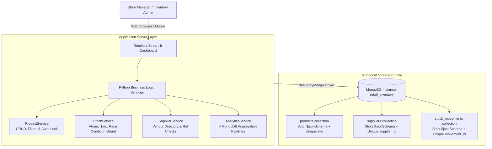

# 📦 Retailerz — Real-Time Inventory & Stock Analytics Platform

<p align="center">
  
  
  
  
  
  
</p>

---

## 📌 Overview

**Retailerz** is a high-performance, full-stack retail inventory management and business intelligence platform designed for small-to-medium retail operations. Engineered with **MongoDB** as its primary document database and **PyMongo** for Python integration, Retailerz delivers end-to-end stock control, supplier relationship management, atomic ledger transactions, and real-time aggregation analytics.

### Why MongoDB?
Traditional relational databases often suffer from rigid schema overhead and heavy locking bottlenecks during high-frequency stock movements. Retailerz uses MongoDB's flexible document model, strict database-level `$jsonSchema` validators, unique compound indexing, and powerful Aggregation Framework to compute complex business metrics directly inside the database engine.

---

## 🏛️ System Architecture



---

## ✨ Key Features

- **Executive Analytics Dashboard**: Instant visibility into total catalog volume, physical inventory balances, estimated capital valuation at selling prices, and critical stock depletion alerts.
- **Interactive Visualizations**: Dynamic Plotly charts illustrating category capital distribution, stock health, and unit volume share.
- **Product Lifecycle Management**: Register, browse, search, and update products with multi-attribute filtering (*Category*, *Stock Health*, *Supplier*).
- **Audit-Protected Safe Deletion**: Strict safeguards prohibit deleting any product that has historical stock movement records, preserving accounting auditability.
- **Atomic Stock Operations**:
  - **Stock IN**: Restock inventory and automatically record arrival logs.
  - **Stock OUT**: Concurrency-safe dispatch with atomic condition checks preventing negative inventory balances.
  - **Inventory Adjustments**: Record cycle counts and shrinkage with signed adjustments.
- **Supplier Directory**: Manage vendor contacts and protect against orphaned products via referential checks.
- **MongoDB Aggregation Inspector**: View real-time pipeline outputs alongside the exact multi-stage JSON aggregation queries.

---

## 🗄️ Database Schema & Validation

Retailerz enforces data integrity at the database level using strict **MongoDB JSON Schema validators** (`validationAction: "error"`, `validationLevel: "strict"`).

### 1. `products` Collection
Stores catalog items, pricing, current stock levels, and safety replenishment thresholds.
```javascript
{
  "_id": ObjectId("..."),
  "sku": "BEV-001",                   // Unique String (Indexed)
  "name": "Orange Juice 1L",          // Required Non-empty String
  "category": "Beverages",            // Required String
  "supplier_id": "SUP-001",           // Foreign reference to supplier
  "unit_price": 3.50,                 // Numeric >= 0.0
  "quantity_in_stock": 18,            // Integer >= 0
  "reorder_level": 20,                // Integer >= 0
  "created_at": ISODate("..."),       // BSON Date
  "updated_at": ISODate("...")        // BSON Date
}
```

### 2. `suppliers` Collection
Vendor directory and operational contact profiles.
```javascript
{
  "_id": ObjectId("..."),
  "supplier_id": "SUP-001",           // Unique String (Indexed)
  "name": "Harbor Beverage Supply",   // Required String
  "contact_person": "Meera Iyer",     // String
  "phone": "+91-555-0101",            // Validated Phone String
  "email": "orders@harborbev.com",    // Validated Email String
  "city": "Pune"                      // Operating City
}
```

### 3. `stock_movements` Collection
Append-only transactional ledger recording every physical stock adjustment.
```javascript
{
  "_id": ObjectId("..."),
  "movement_id": "MOV-0021",          // Unique String (Indexed)
  "sku": "BEV-001",                   // Product SKU Reference
  "movement_type": "OUT",             // Enum: ["IN", "OUT", "ADJUSTMENT"]
  "quantity": 62,                     // Integer (IN/OUT >= 1; ADJUSTMENT != 0)
  "reason": "Weekly sales",           // Required String
  "movement_date": ISODate("...")     // BSON Date
}
```

---

## 🛡️ Concurrency & Stock Safety

### Atomic Conditional Updates
To eliminate race conditions and negative inventory during concurrent orders, stock-out transactions execute an atomic conditional `$inc` update:
```python
result = db.products.update_one(
    {"sku": sku, "quantity_in_stock": {"$gte": requested_qty}},
    {"$inc": {"quantity_in_stock": -requested_qty}, "$set": {"updated_at": now}}
)
if result.modified_count == 0:
    raise InsufficientStockError("Available inventory cannot fulfill requested quantity.")
```

### Transactional Rollback & Compensation
- **Replica Sets & MongoDB Atlas**: Stock updates and ledger records execute within a multi-document ACID transaction session (`client.start_session()`).
- **Standalone Deployments**: Employs an automated compensation rollback mechanism: if writing the movement record fails, the inventory decrement is immediately reversed.

---

## 📊 Real-Time Aggregation Pipelines

All metrics are computed **100% inside MongoDB** using native aggregation pipelines:

| Pipeline | Objective | Key Operators Used |
|---|---|---|
| **1. Low-Stock Alert** | Identifies items at or below safety reorder threshold (`stock <= reorder_level`). | `$match`, `$expr`, `$lte`, `$project`, `$sort` |
| **2. Inventory Valuation** | Aggregates physical units and total capital value per category (`quantity * price`). | `$group`, `$sum`, `$multiply`, `$round`, `$sort` |
| **3. Movement Velocity** | Joins stock movements to product categories to analyze receipt vs. dispatch volume. | `$lookup`, `$unwind`, `$group`, `$cond`, `$sum` |
| **4. Supplier Exposure** | Evaluates vendor concentration and inventory value share across all suppliers. | `$lookup`, `$unwind`, `$group`, `$sum`, `$sort` |
| **5. Ledger Reconciliation** | Verifies data integrity: `Current Stock == Sum(IN) - Sum(OUT) + Sum(ADJUSTMENT)`. | `$lookup`, `$addFields`, `$reduce`, `$cond` |

---

## ⚡ Quick Start & Setup

### Prerequisites
- **Python 3.10+**
- **MongoDB 4.4+** (Local Community Server or MongoDB Atlas cluster)

### 1. Installation
Clone the repository and install dependencies:
```bash
git clone https://github.com/your-username/retailerz-inventory-analytics.git
cd retailerz-inventory-analytics
pip install -r requirements.txt
```

### 2. Configure Environment (Optional)
The system defaults to `mongodb://localhost:27017` and database `retail_inventory`. To customize, set the environment variable:
```bash
# Windows PowerShell
$env:MONGODB_URI = "mongodb://localhost:27017"

# Linux / macOS
export MONGODB_URI="mongodb://localhost:27017"
```

### 3. Initialize Database & Validation Rules
Configures collections, strict JSON schema validators, and unique indexes:
```bash
python -m scripts.init_db
```

### 4. Seed Demonstration Inventory
Populates realistic fictional inventory (5 suppliers, 20 products, 45 movement transactions):
```bash
python -m scripts.seed_data
```
*(Idempotent: Safe to execute repeatedly without generating duplicate documents).*

### 5. Launch the Dashboard
```bash
streamlit run app.py
```
Open **`http://localhost:8501`** in your browser.

---

## 🧪 Automated Testing

The project includes an integration and unit test suite verified against real MongoDB instances:

```bash
python -m pytest -v
```

### Test Coverage Highlights:
- **`test_connection.py`**: Health check pings, connection failovers, and graceful error messages.
- **`test_validation.py`**: Proves MongoDB engine rejects invalid documents (`WriteError code 121`), duplicate SKUs, negative prices, and bad phone/email formats.
- **`test_crud.py`**: Complete product and supplier CRUD lifecycle with temporary records.
- **`test_stock_operations.py`**: Verifies atomic Stock IN, Stock OUT, signed adjustments, insufficient stock rejection, and concurrency safety.
- **`test_analytics.py`**: Validates mathematical accuracy for all 4 aggregation pipelines and ledger reconciliation.

**Test Summary:**
```text
======================= 98 passed, 1 skipped in 8.28s =======================
```

---

## 💻 Tech Stack

- **Persistence Layer**: [MongoDB](https://www.mongodb.com/) (Document Store, Aggregation Engine)
- **Database Driver**: [PyMongo](https://pymongo.readthedocs.io/)
- **Application Logic**: Python 3.10+
- **User Interface**: [Streamlit](https://streamlit.io/) (Dark Mode)
- **Data Visualization**: [Plotly Express & Graph Objects](https://plotly.com/python/)
- **Data Structures**: [Pandas](https://pandas.pydata.org/)
- **Test Framework**: [PyTest](https://docs.pytest.org/)

---

## 📄 License

Distributed under the MIT License. See `LICENSE` for more information.
