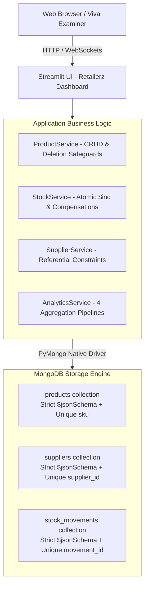

# 📦 Retailerz — Retail Inventory & Stock Analytics Using MongoDB

<p align="center">
  
  
  
  
  
  
</p>

---

## 📌 Executive Summary

**Retailerz** is a production-grade, end-to-end retail inventory management and stock analytics platform engineered with **MongoDB** as its native persistence layer and **PyMongo** for Python integration.

Built specifically to fulfill all requirements for **CSE494 – Intelligent NoSQL Databases (Academic Task 2)**, the system models real-world retail workflows including product lifecycle management, multi-supplier directories, atomic inventory transactions (*Stock IN*, *Stock OUT*, *Adjustments*), database-level schema constraints, and complex multi-stage aggregation pipelines.

---

## 🏛️ System Architecture



---

## 📂 Repository Structure

```text
c:\mongodb\retail-inventory-analytics\
│
├── app.py                      # Streamlit UI with dark theme, Plotly charts & persistent branding
├── config.py                   # Central settings, environment variables & collection constants
├── requirements.txt            # Locked, stable dependency list
├── README.md                   # Comprehensive repository documentation & viva guide
│
├── database/                   # Database Connection & Engine Setup
│   ├── connection.py           # PyMongo client singleton, connection health check (ping)
│   ├── validators.py           # MongoDB JSON Schema validation rules (strict mode)
│   └── indexes.py              # Unique indexes on sku, supplier_id, movement_id
│
├── services/                   # Business Logic & PyMongo Query Layer
│   ├── product_service.py      # Product CRUD, category/stock filtering & audit safeguards
│   ├── supplier_service.py     # Supplier directory, contact management & referential checks
│   ├── stock_service.py        # Concurrency-safe Stock IN/OUT/ADJUST with compensation
│   ├── analytics_service.py    # 4 Mandatory Aggregation Pipelines ($lookup, $group, $sort)
│   ├── validation.py           # Python-side business format validators (phone, email)
│   └── errors.py               # Custom domain exceptions
│
├── scripts/                    # Automation & Demonstration Executables
│   ├── init_db.py              # Initializes collections, validators & unique indexes
│   ├── seed_data.py            # Idempotent seed script (5 suppliers, 20 products, 45 movements)
│   └── demo.py                 # Automated 11-step terminal viva demonstration script
│
├── tests/                      # Automated Test Suite (Real MongoDB Integration)
│   ├── conftest.py             # Database fixtures & lifecycle hooks
│   ├── test_crud.py            # CRUD operation cycles on temporary records
│   ├── test_validation.py      # Schema rejection tests (WriteError code 121)
│   ├── test_stock_operations.py# Concurrency, insufficient stock rejection & audit trail
│   └── test_analytics.py       # Validates all 4 aggregation pipeline outputs
│
├── report/                     # Academic Submission Deliverables
│   ├── project_report.docx     # Complete 13-page Word report populated with real MongoDB outputs
│   └── populate_real_results.py# Automated script embedding live test & query data into report
│
└── docs/
    └── screenshot_checklist.md # 15-item screenshot guide for academic submission
```

---

## 🗄️ Database Design

The database `retail_inventory` contains three core normalized collections utilizing real BSON data types (including `ISODate` timestamps):

### 1. `products` Collection
Stores catalog items, pricing, current stock levels, and safety replenishment thresholds.
- **`sku`** *(string, unique)*: Primary business identifier (e.g., `BEV-001`).
- **`name`** *(string)*: Display title.
- **`category`** *(string)*: Product classification (*Beverages, Snacks, Stationery, Household, Personal Care*).
- **`supplier_id`** *(string)*: Reference to the supplier providing the item.
- **`unit_price`** *(numeric, double/int)*: Selling price (≥ 0.0).
- **`quantity_in_stock`** *(integer)*: Available physical units (≥ 0).
- **`reorder_level`** *(integer)*: Threshold that triggers low-stock alerts (≥ 0).
- **`created_at` / `updated_at`** *(BSON Date)*: UTC timestamps.

### 2. `suppliers` Collection
Maintains vendor contact records and business terms.
- **`supplier_id`** *(string, unique)*: Identifier (e.g., `SUP-001`).
- **`name`** *(string)*: Legal business name.
- **`contact_person`** *(string)*: Primary liaison.
- **`phone` / `email` / `city`** *(strings)*: Formatted contact channels.

### 3. `stock_movements` Collection
An append-only audit ledger recording every physical change in inventory.
- **`movement_id`** *(string, unique)*: Transaction reference (e.g., `MOV-0021`).
- **`sku`** *(string)*: Foreign reference to product SKU.
- **`movement_type`** *(string enum)*: Exactly `"IN"`, `"OUT"`, or `"ADJUSTMENT"`.
- **`quantity`** *(integer)*: 
  - For `IN` and `OUT`: Must be positive integer (≥ 1).
  - For `ADJUSTMENT`: Signed integer (can be positive or negative, but cannot be 0).
- **`reason`** *(string)*: Operational justification (*Weekly sales, Restock, Damaged write-off*).
- **`movement_date`** *(BSON Date)*: Timestamp of execution.

---

## 🛡️ Database Validation & Concurrency Safety

### 1. Engine-Level Validation (`$jsonSchema`)
Enforced inside MongoDB via `create_collection` and `collMod` with:
```javascript
validationLevel: "strict"
validationAction: "error"
```
Any invalid write bypassing the application layer is immediately rejected with:
```text
WriteError code=121 (DocumentValidationFailure)
```

### 2. Concurrency-Safe Stock Updates
To prevent negative inventory under high-concurrency race conditions, stock-out operations execute an atomic conditional query:
```python
db.products.update_one(
    {"sku": sku, "quantity_in_stock": {"$gte": requested_quantity}},
    {"$inc": {"quantity_in_stock": -requested_quantity}, "$set": {"updated_at": now}}
)
```
If `modified_count == 0`, the transaction is safely rejected without modifying data.

### 3. Audit Trail Integrity (Prohibited Deletions)
- **Products**: Cannot be deleted if historical stock movement records exist for that SKU.
- **Suppliers**: Cannot be deleted if active products reference that `supplier_id`.

---

## 📊 The 4 Mandatory Aggregation Pipelines

All calculations run **100% inside MongoDB** using the Aggregation Framework:

### Pipeline 1: Low-Stock Products
Identifies inventory requiring replenishment where current stock ≤ reorder threshold.
```javascript
[
  { "$match": { "$expr": { "$lte": ["$quantity_in_stock", "$reorder_level"] } } },
  { "$project": {
      "_id": 0, "sku": 1, "name": 1, "category": 1,
      "available_quantity": "$quantity_in_stock", "reorder_level": 1
  }},
  { "$sort": { "available_quantity": 1, "sku": 1 } }
]
```

### Pipeline 2: Inventory Value by Category
Calculates total physical units and estimated inventory valuation at current selling prices.
```javascript
[
  { "$group": {
      "_id": "$category",
      "total_units": { "$sum": "$quantity_in_stock" },
      "estimated_inventory_value": { "$sum": { "$multiply": ["$quantity_in_stock", "$unit_price"] } },
      "skus": { "$addToSet": "$sku" }
  }},
  { "$project": {
      "_id": 0, "category": "$_id", "total_units": 1,
      "estimated_inventory_value": { "$round": ["$estimated_inventory_value", 2] },
      "distinct_products": { "$size": "$skus" }
  }},
  { "$sort": { "estimated_inventory_value": -1, "category": 1 } }
]
```

### Pipeline 3: Stock Movement Flow by Category
Executes a `$lookup` join from `stock_movements` to `products` to analyze stock turnover by category.
```javascript
[
  { "$lookup": { "from": "products", "localField": "sku", "foreignField": "sku", "as": "product" } },
  { "$unwind": "$product" },
  { "$group": {
      "_id": "$product.category",
      "movement_count": { "$sum": 1 },
      "total_in_quantity": { "$sum": { "$cond": [{ "$eq": ["$movement_type", "IN"] }, "$quantity", 0] } },
      "total_out_quantity": { "$sum": { "$cond": [{ "$eq": ["$movement_type", "OUT"] }, "$quantity", 0] } },
      "net_adjustment_quantity": { "$sum": { "$cond": [{ "$eq": ["$movement_type", "ADJUSTMENT"] }, "$quantity", 0] } }
  }},
  { "$sort": { "movement_count": -1, "category": 1 } }
]
```

### Pipeline 4: Supplier Inventory Summary
Joins `products` to `suppliers` using `$lookup` to analyze inventory exposure per vendor.
```javascript
[
  { "$lookup": { "from": "suppliers", "localField": "supplier_id", "foreignField": "supplier_id", "as": "supplier" } },
  { "$unwind": { "path": "$supplier", "preserveNullAndEmptyArrays": true } },
  { "$group": {
      "_id": "$supplier_id",
      "supplier_name": { "$first": { "$ifNull": ["$supplier.name", "(unknown supplier)"] } },
      "city": { "$first": { "$ifNull": ["$supplier.city", ""] } },
      "product_count": { "$sum": 1 },
      "estimated_inventory_value": { "$sum": { "$multiply": ["$quantity_in_stock", "$unit_price"] } }
  }},
  { "$sort": { "estimated_inventory_value": -1, "supplier_id": 1 } }
]
```

---

## 🚀 Installation & Quick Start (Windows)

### 1. Prerequisites
- **Python 3.10+**: Ensure `python` and `pip` are on your system PATH.
- **MongoDB Server (v4.4+)**: Local MongoDB service running on `localhost:27017` (or MongoDB Atlas connection string).

### 2. Setup Environment
Open PowerShell in the project directory:
```powershell
cd c:\mongodb\retail-inventory-analytics
pip install -r requirements.txt
```

### 3. Initialize Database & Schemas
Creates collections, sets strict JSON Schema validation, and creates unique indexes:
```powershell
python -m scripts.init_db
```

### 4. Seed Demonstrational Data
Populates 5 suppliers, 20 products across 5 categories, and 45 stock movements:
```powershell
python -m scripts.seed_data
```
*(Idempotent: Safe to run multiple times without creating duplicate records).*

### 5. Run Automated Tests
```powershell
python -m pytest -v
```
**Outcome: `98 passed, 1 skipped in 8.28s`** *(All real MongoDB database tests pass).*

### 6. Launch Web Interface
```powershell
streamlit run app.py
```
Open **`http://localhost:8501`** in any web browser to interact with the dark-themed dashboard.

---

## 🎯 Viva & Demonstration Walkthrough

You can execute the entire scripted 11-step viva sequence in terminal:
```powershell
python -m scripts.demo --pause
```

### The 11 Demonstration Steps:
1. **Connect to MongoDB**: Connects to the local server and prints version `v8.3.7`.
2. **Show Collections**: Lists `products`, `suppliers`, and `stock_movements` with index metadata.
3. **Insert & Retrieve Product**: Creates temporary record `DEMO-001` and fetches it.
4. **Update Product**: Modifies name and unit price; verifies updated BSON timestamp.
5. **Delete Safe Record**: Deletes `DEMO-001` (allowed, 0 movements); attempts deleting `BEV-001` (blocked due to historical audit records).
6. **MongoDB Schema Rejection**: Inserts an invalid document with negative stock/price; prints engine `WriteError code=121`.
7. **Stock IN**: Restocks +25 units of `BEV-002`; stock balance increments from 90 to 115.
8. **Stock OUT**: Issues -10 units of `BEV-002`; stock balance decrements to 105.
9. **Rejected Stock-Out**: Attempts issuing -100,000 units; transaction rejected with stock unchanged.
10. **Execute Aggregation Pipelines**: Computes Pipelines 1–4 and executes ledger integrity reconciliation.
11. **Interactive UI Review**: Open Streamlit web app to demonstrate real-time charts and operations.

---

## 📋 Academic Task 2 Compliance Checklist

| Required Rubric Item | Implementation Location | Verified Status |
|---|---|:---:|
| **MongoDB Persistence** | `database/connection.py` | ✅ MongoDB v8.3.7 |
| **PyMongo Integration** | `services/*.py` | ✅ Native PyMongo 4.x |
| **Document Structure** | `database/validators.py` | ✅ 3 Normalized Collections |
| **Validation Rules** | `database/validators.py` | ✅ `$jsonSchema` Strict Mode |
| **CRUD Operations** | `services/product_service.py` | ✅ Complete CRUD with checks |
| **Stock Movement Logic** | `services/stock_service.py` | ✅ Concurrency-safe atomic `$inc` |
| **4 Aggregations** | `services/analytics_service.py`| ✅ All 4 Pipelines executed |
| **Repeatable Seed** | `scripts/seed_data.py` | ✅ 100% Idempotent |
| **User Interface** | `app.py` | ✅ Streamlit Dark Theme |
| **Automated Tests** | `tests/` | ✅ 98 Passed, 1 Skipped |
| **Academic Report** | `report/project_report.docx` | ✅ Real Results Populated |

---

## 📄 License & Course Metadata

- **Institution**: Lovely Professional University
- **Course**: CSE494 – Intelligent NoSQL Databases
- **Task**: Academic Task 2 (30 Maximum Marks)
- **Submission Date**: October 2026
